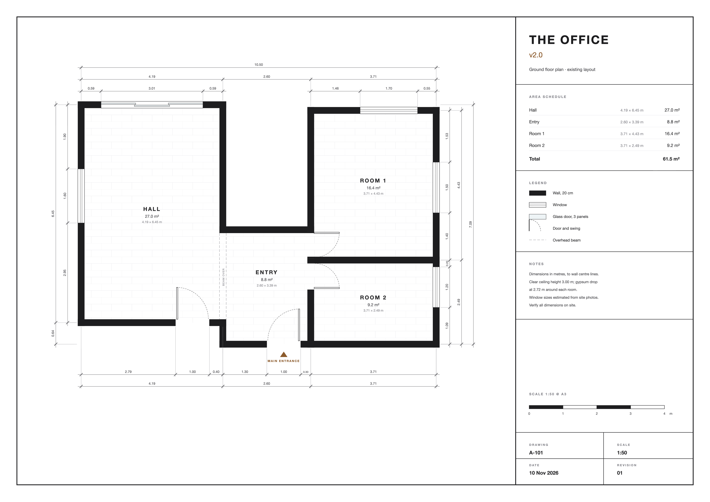

# The Office v2.0

Empty 3D model and 2D floor plan of the new office, built from the floor plan (100 pt = 1 m) and site photos.

- **3D model:** https://abolsaraseer.github.io/the_office_v2.0/
- **2D floor plan:** https://abolsaraseer.github.io/the_office_v2.0/plan.html ([PDF](plan.pdf), [SVG](plan.svg), [PNG](plan.png))
- **3D file:** [`the_office.glb`](the_office.glb), opens in Blender, SketchUp or any glTF viewer

| Space  | Size          | Area    |
|--------|---------------|---------|
| Hall   | 4.19 × 6.45 m | 27.0 m² |
| Entry  | 2.60 × 3.39 m | 8.8 m²  |
| Room 1 | 3.71 × 4.43 m | 16.4 m² |
| Room 2 | 3.71 × 2.49 m | 9.2 m²  |
| **Total** |            | **61.5 m²** |

Dimensions are to wall centre lines (20 cm walls). Ceiling height 3.00 m. Window sizes are estimated from site photos.

